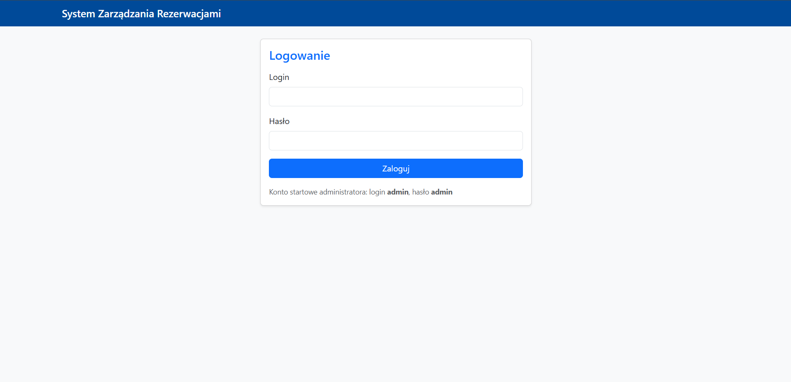
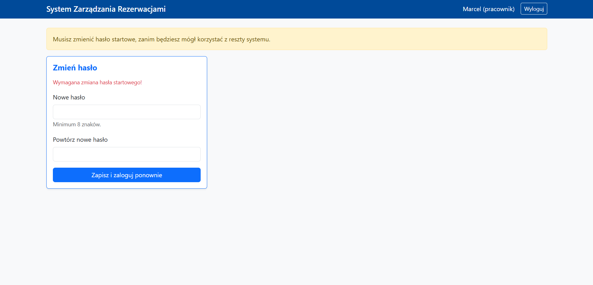
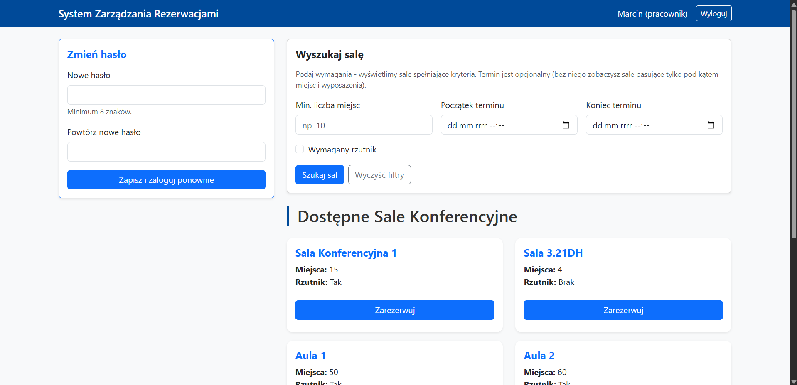
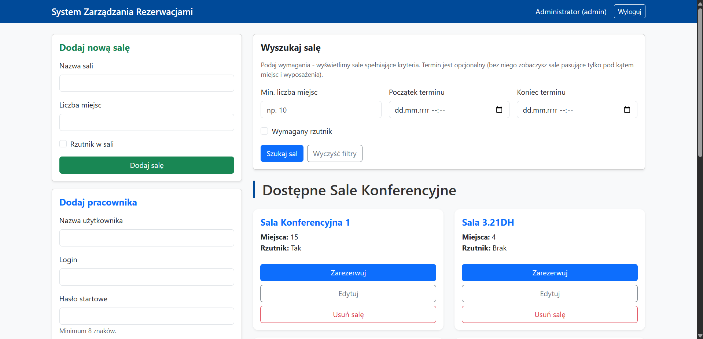
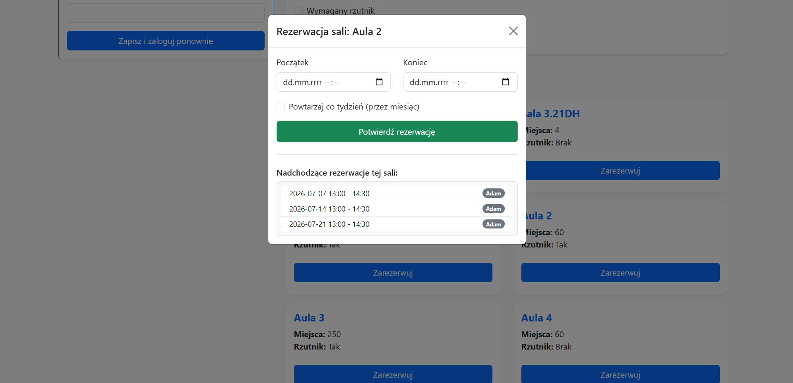
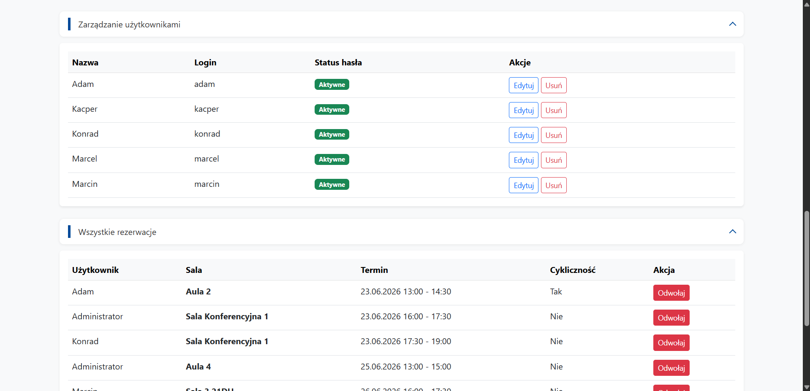

# 🏢 System Zarządzania Rezerwacjami Sal / Room Booking System

## O projekcie

Wewnętrzna aplikacja webowa do rezerwacji sal konferencyjnych w firmie. Projekt z przedmiotu **Projekt Zespołowy**, robiony etapami na zajęciach.

System pozwala pracownikom przeglądać sale, filtrować je według wymagań i rezerwować terminy. Administrator zarządza salami, użytkownikami i ma podgląd wszystkich rezerwacji w systemie.

### 👥 Role użytkowników

* **Administrator:** dodaje, edytuje i usuwa sale, zakłada i zarządza kontami pracowników, widzi wszystkie rezerwacje w systemie, może je odwoływać (także cudze).

* **Pracownik:** wyszukuje sale, składa rezerwacje, zarządza własnymi rezerwacjami, zmienia hasło.

### 🔧 Panel administratora (szczegóły)

**Sale:**

* dodawanie nowej sali (nazwa, liczba miejsc, informacja o rzutniku),

* edycja istniejącej sali,

* usuwanie sali tylko wtedy, gdy **nie ma do niej żadnych rezerwacji** (system blokuje usunięcie i zwraca komunikat błędu).

**Użytkownicy (pracownicy):**

* dodawanie konta z hasłem startowym (minimum 8 znaków),

* edycja nazwy, loginu i opcjonalnie hasła,

* usuwanie pracownika wraz z jego rezerwacjami,

* administrator **nie może** edytować ani usunąć własnego konta admina przez panel użytkowników,

* przy usuwaniu nie da się skasować samego siebie.

**Rezerwacje:**

* podgląd wszystkich rezerwacji w systemie,

* odwoływanie dowolnej rezerwacji (nie tylko własnej),

* sekcje na dole panelu są zwijane (użytkownicy, wszystkie rezerwacje, moje rezerwacje).

### 🛠️ Technologie i architektura

* **Backend:** Python, Flask, SQLAlchemy (ORM)

* **Baza danych:** SQLite (`database.db` tworzona automatycznie przy pierwszym uruchomieniu)

* **Frontend:** HTML, Bootstrap 5, JavaScript (fetch API)

* **Bezpieczeństwo:** hashowanie haseł (`werkzeug.security`), tokeny CSRF (`Flask-WTF`), sesje z podziałem ról

### 🔒 Bezpieczeństwo

* hasła w bazie są hashowane, nie trzymamy ich jako zwykły tekst,

* przy logowaniu sprawdzane są role (`admin` / `pracownik`), a chronione strony wymagają zalogowania,

* operacje administratora (sale, użytkownicy) są dodatkowo blokowane dla pracownika,

* formularze i żądania API (POST/PUT/DELETE) mają ochronę CSRF,

* nowy pracownik z hasłem startowym **musi je zmienić** zanim zrobi cokolwiek innego w systemie,

* pracownik może odwołać tylko swoją rezerwację, admin może odwołać każdą,

* hasło startowe i nowe hasło muszą mieć co najmniej 8 znaków.

### ⚠️ Walidacja i obsługa błędów

Aplikacja sprawdza dane po stronie serwera i pokazuje komunikaty po polsku (alerty na stronie lub w oknach modalnych):

* puste pola, zły format daty, koniec przed początkiem rezerwacji,

* zajęta sala w wybranym terminie (także przy rezerwacji cyklicznej),

* duplikat loginu lub nazwy sali,

* pojemność sali musi być liczbą większą od zera,

* próba usunięcia sali z rezerwacjami,

* brak uprawnień (np. pracownik próbuje wejść w funkcje admina),

* błędy zapisu do bazy z `rollback` transakcji, żeby nie zostawić niespójnych danych.

API zwraca sensowne kody HTTP (400, 403, 404, 409, 500) z opisem błędu w JSON.

### ⚙️ Najważniejsze funkcje

* Logowanie z podziałem na role (`admin` / `pracownik`)

* Wymuszenie zmiany hasła startowego u nowego pracownika

* Wyszukiwanie sal po liczbie miejsc, rzutniku i opcjonalnym terminie (sprawdzanie dostępności)

* Rezerwacja pojedyncza lub cykliczna (co tydzień przez miesiąc)

* Walidacja konfliktów terminów, system nie pozwala na nakładające się rezerwacje

* Panel administratora ze zwijanymi sekcjami (użytkownicy, wszystkie rezerwacje, moje rezerwacje)

* REST API pod ścieżkami `/api/...` obsługiwane z poziomu panelu

### 📌 Stan projektu

To nadal **prototyp** studencki. Do zrobienia m.in. podział kodu na osobne moduły i migracje bazy (np. Flask-Migrate).

## 🇬🇧 English Version

### About the Project

An internal web application for booking conference rooms in a company. This is a university **Team Project** assignment, developed iteratively during classes.

The system allows employees to browse rooms, filter them by requirements, and book time slots. The administrator manages rooms and users, and has an overview of all reservations in the system.

### 👥 User Roles

* **Administrator:** adds, edits, and deletes rooms; creates and manages employee accounts; views all system reservations; can cancel any reservation (including those made by others).

* **Employee:** searches for rooms, makes reservations, manages their own reservations, and changes their password.

### 🔧 Admin Panel Details

**Rooms:**

* adding a new room (name, seating capacity, projector availability),

* editing an existing room,

* deleting a room only if **there are no active reservations** for it (the system blocks deletion and returns an error message).

**Users (Employees):**

* adding an account with a temporary password (minimum 8 characters),

* editing name, login, and optionally the password,

* deleting an employee along with their reservations,

* the administrator **cannot** edit or delete their own admin account through the user panel,

* self-deletion is prevented.

**Bookings:**

* overview of all reservations in the system,

* canceling any reservation (not just their own),

* bottom sections of the panel are collapsible (users, all bookings, my bookings).

### 🛠️ Technologies and Architecture

* **Backend:** Python, Flask, SQLAlchemy (ORM)

* **Database:** SQLite (`database.db` created automatically on first run)

* **Frontend:** HTML, Bootstrap 5, JavaScript (Fetch API)

* **Security:** password hashing (`werkzeug.security`), CSRF tokens (`Flask-WTF`), role-based sessions

### 🔒 Security

* passwords are hashed in the database; no plain-text storage,

* roles (`admin` / `employee`) are verified upon login, and protected pages require authentication,

* admin-only operations (rooms, users) are strictly blocked for regular employees,

* forms and API requests (POST/PUT/DELETE) have CSRF protection,

* a new employee with a temporary password **must change it** before performing any other action in the system,

* employees can only cancel their own reservations; admins can cancel any,

* both temporary and new passwords must be at least 8 characters long.

### ⚠️ Validation and Error Handling

The application performs server-side data validation and displays Polish error messages (alerts on the page or in modal windows) for:

* empty fields, invalid date formats, or end time preceding start time,

* room occupied in the selected time slot (including recurring reservations),

* duplicate login or room name,

* room capacity must be a number greater than zero,

* attempting to delete a room with active reservations,

* permission denial (e.g., an employee trying to access admin functions),

* database save errors trigger a transaction `rollback` to prevent data inconsistency.

The API returns proper HTTP status codes (400, 403, 404, 409, 500) along with JSON error descriptions.

### ⚙️ Key Features

* Role-based login (`admin` / `employee`)

* Forced temporary password change for new employees

* Room search by capacity, projector, and optional time slot (availability check)

* Single or recurring reservations (weekly for a month)

* Schedule conflict validation; the system prevents overlapping reservations

* Admin panel with collapsible sections (users, all reservations, my reservations)

* REST API under `/api/...` paths, utilized by the frontend panel

### 📌 Project Status

This is still a student **prototype**. Future tasks include splitting the code into separate modules and implementing database migrations (e.g., using Flask-Migrate).

## 📸 Zrzuty ekranu / Screenshots

*Ekran logowania / Login page*



*Pierwsze logowanie pracownika, wymuszona zmiana hasła / First login, password change required*



*Panel główny pracownika / Employee main panel*



*Panel główny administratora / Admin main panel*



*Rezerwacja sali / Room reservation*



*Panel administratora, rozwinięte sekcje na dole (użytkownicy, rezerwacje) / Admin panel, expanded bottom sections*




## 🚀 Uruchomienie lokalne / Local setup

```bash
git clone https://github.com/Marcin10H/Projekt-Zespo-owy---Hajduk-Go-ucki-Gaw-da.git
cd Projekt-Zespo-owy---Hajduk-Go-ucki-Gaw-da

python -m venv venv
.\venv\Scripts\activate        # Windows
# source venv/bin/activate     # Linux / macOS

python -m pip install -r requirements.txt
python app.py
```

Aplikacja działa pod adresem: **http://127.0.0.1:5000**

**Konto startowe administratora:** login `admin`, hasło `admin`
